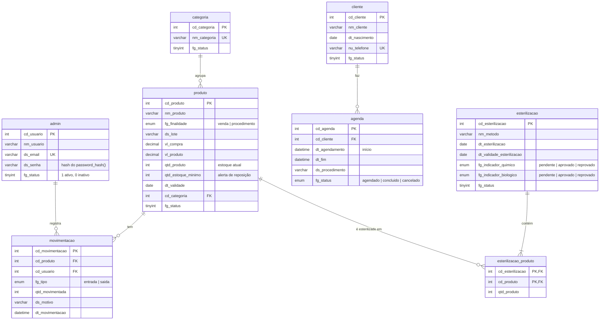

# Modelagem do banco de dados

Banco: **glowbella** (MySQL/MariaDB, `utf8mb4`, InnoDB)

O diagrama abaixo é renderizado automaticamente pelo GitHub.



## Padrão de nomes

| Prefixo | Significado | Exemplo |
|---|---|---|
| `cd_` | Código (chave primária ou estrangeira) | `cd_produto` |
| `nm_` | Nome | `nm_cliente` |
| `ds_` | Descrição ou texto | `ds_procedimento` |
| `dt_` | Data ou data e hora | `dt_agendamento` |
| `vl_` | Valor em dinheiro | `vl_produto` |
| `qtd_` | Quantidade | `qtd_estoque_minimo` |
| `nu_` | Número de contato ou documento (guardado como texto) | `nu_telefone` |
| `fg_` | Situação ou tipo, com valores fixos | `fg_status` |

Tabelas no **singular** e em minúsculas.

## Tabelas

| Tabela | Para que serve |
|---|---|
| `admin` | Quem acessa o sistema (dona e funcionárias) |
| `categoria` | Agrupa os produtos (Brincos, Piercings, Acessórios) |
| `cliente` | Cadastro de clientes |
| `produto` | Catálogo, lote, validade e estoque atual de cada item |
| `movimentacao` | Histórico de entradas e saídas de estoque |
| `agenda` | Horários marcados para cada cliente |
| `esterilizacao` | Ciclos de esterilização (ex.: autoclave) e seus indicadores |
| `esterilizacao_produto` | Quais produtos (e quantos) foram esterilizados em cada ciclo |
| `migracoes` | Controle interno do `database/migrar.php` |

## Valores dos campos `fg_`

| Campo | Valores |
|---|---|
| `fg_status` em `admin`, `categoria`, `cliente`, `produto` e `esterilizacao` | `1` ativo, `0` inativo |
| `agenda.fg_status` | `agendado`, `concluido`, `cancelado` |
| `produto.fg_finalidade` | `venda` (vendido à cliente) ou `procedimento` (usado nos atendimentos) |
| `movimentacao.fg_tipo` | `entrada` ou `saida` |
| `esterilizacao.fg_indicador_quimico` e `fg_indicador_biologico` | `pendente`, `aprovado`, `reprovado` |

## Regras de negócio importantes

**Estoque**
- `produto.qtd_produto` é o estoque atual, mas **nunca deve ser alterado diretamente**. Toda mudança acontece junto com um registro em `movimentacao`, dentro de uma transação:
  ```php
  $pdo->beginTransaction();
  // 1. INSERT INTO movimentacao (cd_produto, cd_usuario, fg_tipo, qtd_movimentada, ds_motivo) ...
  // 2. UPDATE produto SET qtd_produto = qtd_produto + ? WHERE cd_produto = ?                      (entrada)
  //    UPDATE produto SET qtd_produto = qtd_produto - ? WHERE cd_produto = ? AND qtd_produto >= ?  (saída)
  $pdo->commit();
  ```
- Na saída, se o `UPDATE` não afetar nenhuma linha (`rowCount() === 0`), é porque não há estoque suficiente: faça `rollBack()` e mostre o erro.
- **Estoque baixo:** `qtd_produto < qtd_estoque_minimo`.
- **Validade vencendo:** `dt_validade` próxima de `CURDATE()`.

**Exclusões**
- Admin, categoria, cliente, produto e esterilização **não são apagados**: são desativados (`fg_status = 0`). Assim o histórico continua existindo.
- As chaves estrangeiras usam `ON DELETE RESTRICT`: o banco impede apagar uma cliente que tem agendamentos, ou uma categoria que tem produtos. Trate esse erro mostrando uma mensagem amigável.

**Agenda**
- `dt_agendamento` (início) e `dt_fim` guardam data e hora.
- **Conflito de horário:** existe conflito se algum agendamento não cancelado se sobrepõe ao novo horário:
  ```sql
  SELECT COUNT(*) FROM agenda
  WHERE fg_status <> 'cancelado'
    AND dt_agendamento < :novo_fim
    AND dt_fim > :novo_inicio
  ```

**Esterilização**
- Um ciclo pode levar vários produtos: eles ficam em `esterilizacao_produto`.
- Um ciclo está **válido** quando `dt_validade_esterilizacao >= CURDATE()` e nenhum indicador está `reprovado`.

**Validações garantidas pelo próprio banco**
- Valores (`vl_compra`, `vl_produto`) não podem ser negativos.
- Quantidade de uma movimentação e de um produto no ciclo precisa ser maior que zero.
- `agenda.dt_fim` precisa ser depois de `dt_agendamento`.
- `dt_validade_esterilizacao` não pode ser antes de `dt_esterilizacao`.
- E-mail do admin, telefone da cliente e nome da categoria não se repetem.

## Pontos a confirmar com a cliente

- **Lote:** hoje cada produto tem **um** lote e **uma** validade (`ds_lote` e `dt_validade` em `produto`). Se a loja compra o mesmo produto em lotes com validades diferentes, o lote precisa virar uma tabela própria.
- **Vendas:** se a cliente quiser o registro de vendas, serão criadas as tabelas de venda em uma migration nova, sem alterar as existentes.
